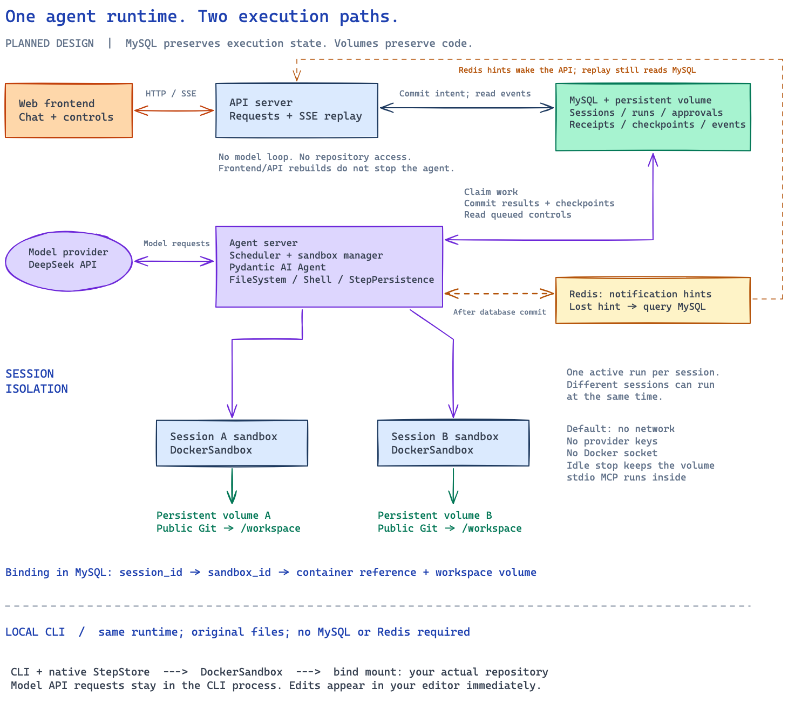

# Pydantic AI Coding Agent Lab

Learn advanced Pydantic AI features by building a terminal coding agent and a web coding agent.

**Status: design only.** This repository contains the specification and learning documents. There is no runnable agent, API, frontend, or deployment yet. Framework versions and extension points still need executable verification.

## What the lab will cover

- File editing and command execution in Docker sandboxes.
- Allowlists, execution approval, receipts, and checkpoint recovery.
- Queue and steer input during a run, with Stop and Continue controls.
- Context compaction, Agent Skills, repository instructions, and MCP.
- Separate frontend, API server, and agent server deployments.
- A session list, MySQL persistence, Redis notifications, and event replay.

The CLI will edit your actual repository through a bind mount. The server will clone a public Git repository into a separate workspace for each session. Both interfaces will use one agent per run. Different sessions can execute concurrently.

## Architecture

MySQL will hold server state. Redis will send notifications only. The API server will handle user requests and event delivery. The agent server will run agents and manage their execution environments. Each server session will have a separate sandbox and workspace volume.

## Read the documents

Start with the [documentation index](docs/README.md). Read the [specification](docs/specification.md) for requirements and the [architecture guide](docs/architecture.md) for component boundaries. The [CLI loop guide](docs/cli-agent-loop.md) locates model calls, tool calls, approvals, receipts, and checkpoints. The [CLI](docs/cli-interactions.md), [Web](docs/web-interactions.md), and [visual](docs/visual-design.md) specifications define the planned user experience. The [decision record](docs/decisions.md) explains the choices.

The design uses public Pydantic AI and Harness capabilities first. Application code will supply only the controls and adapters that the framework does not provide. See the [framework integration guide](docs/integrations.md).

## Scope

Release one targets a single user on a local Docker installation. It will not include user management, sub-agent delegation, file rollback, private Git credentials, or a large command menu. Model requests will use the configured DeepSeek endpoint. Credentials will stay outside Git and tool sandboxes.

## Development

Implementation starts after specification approval. Installation and run commands will be added with working code and test evidence. Do not treat examples in design documents as an available API.

Keep documentation and implementation in the same change. Use English throughout the repository and [Conventional Commits](https://www.conventionalcommits.org/en/v1.0.0/). See [contribution rules](CONTRIBUTING.md).
