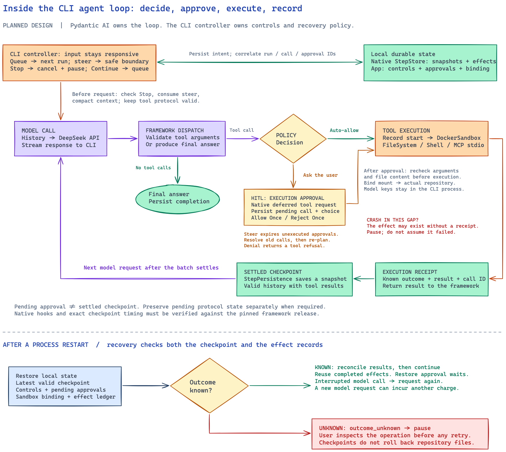

# Inside the CLI Agent Loop

Status: implemented with Pydantic AI 2.61.0 and Harness 0.61.0. The diagram shows ownership and recovery boundaries; the [source walkthrough](implementation.md) maps them to code.

Open the [Excalidraw source](diagrams/cli-agent-loop.excalidraw) to inspect or edit the diagram.

## What owns the loop

Pydantic AI owns the repeated model request, response handling, tool dispatch, and tool-result processing. The CLI controller supplies the model, capabilities, workspace, policy, and persistence adapters. The controller also handles input while the framework runs.

Do not write a second model/tool loop around the framework. Use public hooks and continuation APIs for controls and recovery. One logical application run can span several native continuation calls. That is common when an approval is deferred. The [CLI interaction specification](cli-interactions.md) defines the terminal controls and rendering behavior around this loop.

## Follow one tool call

1. **Accept input.** The CLI persists the user turn. Queue creates a later turn. Steer targets the active run and does not cancel it.
2. **Prepare the next model request.** Check Stop, consume steer input that is eligible, and compact context when required. Keep tool-call/result pairs valid.
3. **Call the model.** Send the effective history to DeepSeek from the CLI process. Stream display output to the terminal. The execution sandbox does not receive the model key.
4. **Dispatch the response.** The framework validates tool arguments. If the response is a final answer, record completion and let the scheduler consider queued work.
5. **Evaluate permission.** Enforce sandbox restrictions and explicit denials. An explicit auto-allow rule can permit execution. Otherwise a mutation or command waits for human approval.
6. **Wait for HITL when required.** Use native deferred approval support. Save the exact pending request and the protocol state. Allow Once applies only to that operation. Reject Once returns a refusal.
7. **Execute.** Check the approved arguments and the file content again. Record that execution started, then call the tool inside DockerSandbox. A local edit changes the real repository through its bind mount.
8. **Record the result.** Save a receipt with the operation identity, the known outcome, and the result data the framework needs. Return the result to the framework. Reuse native effect tracking when it meets this contract.
9. **Save a settled checkpoint.** After the tool batch settles, StepPersistence records a valid message boundary. Continue with the next model request, or finish the run.

The sequence shows who is responsible for each step. Not every tool call or final response writes the same database rows. Probe the selected framework release to confirm the native hooks, when snapshots are taken, and where results are stored.

## Where HITL and approval differ

HITL means human intervention in execution. The HITL path required here is execution approval: the agent proposes one exact operation and waits for Allow Once or Reject Once.

Repository trust is a separate decision, made before loading Skills, MCP configuration, or repository instructions. Trust does not approve later tool calls. A file-change preview is also separate from a completion notification. See [execution events](execution.md#file-events).

If steer arrives during approval, expire the requests that have not executed, resolve the pending tool protocol, and inject the new instruction before the next model request. Keep the logical run. A callback that only waits in memory is not enough for restart-safe HITL.

## Where checkpoints and receipts differ

A checkpoint saves the framework context that execution can continue from. A receipt records what happened to one operation. The application also has to keep pending approvals, consumed control messages, the scheduling pause, and the sandbox binding.

Waiting for approval is not automatically a settled checkpoint. Keep the pending protocol through the serialization and continuation APIs the framework supports. A history snapshot, on its own, does not mean that pending protocol was saved.

A receipt can exist before a newer settled checkpoint. Recovery must line that tool result up with the saved framework history. It must not run the operation again only because the checkpoint is older. A started effect with no receipt does not mean the operation failed.

## What recovery does

On restart, load the latest valid checkpoint and the application control state. Reconnect the sandbox, and inspect the effect records before resuming.

| Failure point | Recovery action |
| --- | --- |
| Before execution, while approval is pending | Restore the request unless Stop or steer invalidated it |
| During a model request | Retry from the valid saved boundary; another provider charge is possible |
| After an effect with a complete recorded result | Reconcile the result and reuse the completed effect |
| After a mutation or command starts, with no confirmed result | Set `outcome_unknown`, pause, and ask the user to inspect the workspace |
| After Stop | Keep the run cancelled and the queue paused; Continue resumes queued work |

Recovery does not roll the repository back. The sandbox limits what execution can reach. It does not make a file change and its receipt one atomic write. See [persistence and recovery](persistence.md) for the full rules.

## What the logs teach

Correlate the logical run, native run, tool call, approval, and checkpoint IDs. Log the permission source, the pending decision, execution start, the receipt, checkpoint save and load, and the recovery decision. The log should show what the framework did and what the application did.

The current diff is an on-demand view of Git and the workspace files. It is not the recovery journal. The [verification plan](verification.md) covers approval restart, stale decisions, steer boundaries, and the case where an effect has no receipt.
