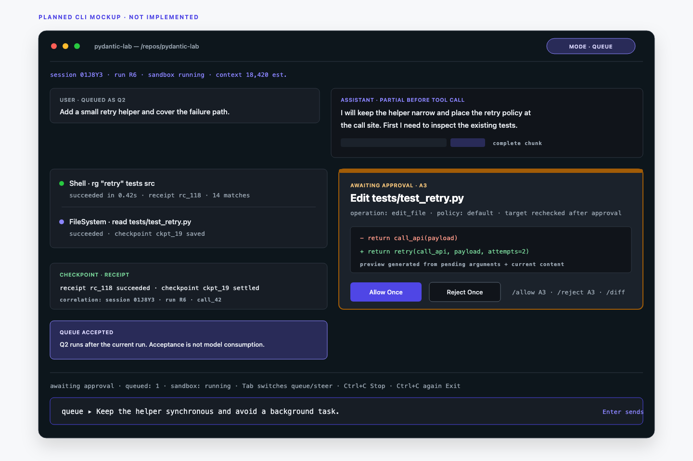

# CLI Interaction Specification

Status: planned. This document defines the terminal experience for the approved architecture. It does not describe an implemented CLI. Command names, key bindings, state labels, and output formats are proposed application contracts. Verify framework hooks and event names against the pinned Pydantic AI and Harness releases before implementation.



## Purpose and boundary

The CLI teaches the agent loop without hiding it. Pydantic AI owns the model/tool loop and emits the events that the selected release supports. The CLI owns input modes, permission prompts, rendering, control persistence, recovery decisions, and the bind-mounted workspace.

The CLI edits the selected real repository through DockerSandbox. It does not use the web API, MySQL, Redis, or a browser session.

## State model

Use these display states. They describe the interface, not framework event names.

| Display state | Meaning | Input composer | Primary control |
| --- | --- | --- | --- |
| `idle` | No active run and no queued work | Enabled | Send starts a run |
| `running` | A logical run is executing | Enabled | Stop |
| `awaiting_approval` | At least one exact operation waits for a decision | Enabled | Allow Once, Reject Once, or Stop |
| `stopped` | Stop cancelled the run and paused scheduling | Enabled | Continue when queued work exists |
| `outcome_unknown` | A mutation or command started, but its outcome is not confirmed | Disabled until the user decides | Continue without retry, Retry once, or Abort |
| `completed` | The run produced a final answer | Enabled | Send starts a new run |
| `failed` | The run ended with a known error | Enabled | Send starts a new run; startup `resume` can select another recoverable session |

A run waiting for approval still owns the session execution slot. Different sessions may run concurrently, but one session never runs two logical runs at the same time.

## Layout

Use an inline terminal layout. Do not use the alternate screen buffer. This keeps terminal scrollback, copy, screen readers, and CI logs useful.

At 100 columns or more:

```text
┌ pydantic-lab ─ session 01J… ─ repo /path/to/repo ─ mode: queue ─────────┐
│ Conversation and execution trace                                        │
│                                                                         │
│ > user message                                                          │
│ Assistant answer streams here                                           │
│ ▸ tool call group                                                       │
│ ◆ approval card                                                         │
├ stopped · queued: 2 · sandbox: running · context: 18,420 est. ──────────┤
│ queue ▸ Type a message. Tab switches queue/steer. Enter sends.          │
└─────────────────────────────────────────────────────────────────────────┘
```

The layout has four regions:

1. **Header:** application name, session, repository path, and active input mode.
2. **Transcript:** user messages, assistant output, tool trace, approvals, and recovery notices in time order.
3. **Status line:** scheduler state, queued count, sandbox state, and the context estimate when the framework provides it.
4. **Composer:** one primary input area. It remains enabled while a run executes or waits for approval.

At 80–99 columns, shorten labels and omit the full repository path. Below 80 columns, use one field per line and remove decorative box edges. Content order does not change.

## Composer and input modes

Queue is the default mode while a run is active. It creates a later run in FIFO order. Steer changes the current logical run at the next safe model boundary.

| Action | Precondition | Feedback | State change | Failure handling |
| --- | --- | --- | --- | --- |
| Send with `queue` | No active run and scheduling is not paused | `Run started` | Creates a run immediately | Show the submission error and keep the draft |
| Send with `queue` | Scheduling is paused after Stop | `Queued as Q2; scheduling is paused until Continue` | Appends a durable FIFO item without starting it | Keep the draft and show the storage error |
| Send with `queue` | Run active or awaiting approval | `Queued as Q2; runs after the current run` | Appends a durable FIFO item | Keep the draft and show the storage error |
| Send with `steer` | Run active or awaiting approval | `Steer recorded; applies at the next safe boundary` | Records steer for the current logical run | Keep the draft and show the storage error |
| Press `Tab` | Run active or awaiting approval | Mode label changes between `queue` and `steer` | Changes only future submissions | If the mode cannot change, keep the current mode and show a local error |
| Press `Enter` | Composer has content | Message leaves the composer after acceptance | Applies the active mode | Do not clear the draft until acceptance is durable |
| Press `Esc` | A detail block is expanded | Collapses the block | Display only | No execution effect |

Show both acceptance and consumption:

```text
Queued as Q2; runs after the current run.
Queue consumed: Q2 is now run R7.

Steer recorded; applies at the next safe boundary.
Steer consumed before model request 4.
```

Acceptance does not mean the model has seen the message. Consumption does. Persist consumption so a restart cannot inject the same steer twice.

## Minimal commands and keys

Keep the command set small. Commands begin with `/` and are not sent to the model.

| Command or key | Precondition | Effect |
| --- | --- | --- |
| `/allow [approval_id]` | Approval is pending | Approves one exact operation once |
| `/reject [approval_id]` | Approval is pending | Returns one refusal to the agent once |
| `/diff` | A workspace exists | Shows the current workspace diff on demand |
| `/trust` | Untrusted or changed repository extensions exist | Opens the trust review |
| `/stop` | A run is active or awaiting approval | Sends the same durable Stop control as the first Ctrl+C |
| `/continue` | Scheduling is paused | Resumes eligible queued work |
| `/continue` | State is `outcome_unknown` | Selects Continue without retry |
| `/retry` | State is `outcome_unknown` | Selects Retry once after the duplicate-effect confirmation |
| `/abort` | State is `outcome_unknown` | Selects Abort after the no-rollback confirmation |
| `Tab` | A run is active or awaiting approval | Switches Queue and Steer |
| `Enter` | Composer has content | Sends the message |
| Pasted multiline text | Composer has content | Preserves newlines in one message |
| `Ctrl+C` | See the next table | Stop first, then exit on a second press |
| `Ctrl+D` | Composer is empty and no run is active | Exits the CLI |

An unknown `/command` produces a local error and stays in the composer. Do not add a command palette or a large slash-command catalog.

### Ctrl+C semantics

| Context | First Ctrl+C | Second Ctrl+C within three seconds |
| --- | --- | --- |
| Idle with an empty composer | Exit | Not applicable |
| Idle with a draft | Clear the draft and show `Draft cleared` | Exit if the composer is now empty |
| Running or awaiting approval | Commit durable Stop, cancel the active run, invalidate pending approvals, keep queued input, and pause scheduling | Exit the CLI process |
| `stopped`, `completed`, `outcome_unknown`, or `failed` | Exit after the current state has been rendered | Exit immediately |
| Stop commit failed | Show the error and do not claim Stop succeeded | Exit after a clear warning that recovery must inspect the run |

Ctrl+C is not a detached local view. During execution, it is the durable Stop control. A fast process exit after the second press can still require restart recovery.

## Streaming and tool display

Render assistant Markdown incrementally. Use terminal formatting for completed Markdown constructs. If a partial construct is ambiguous, show its source text until it completes. Never fabricate a missing final answer after Stop.

Group each tool call with this lifecycle:

| Tool state | Default display |
| --- | --- |
| `requested` | One line with tool name and a safe argument summary |
| `awaiting_approval` | Expanded approval card |
| `running` | Spinner or elapsed time; no fake progress percentage |
| `succeeded` | One-line receipt summary with duration and exit or edit status |
| `failed` | Expanded error summary and retry guidance |
| `cancelled` | One-line stopped marker |
| `outcome_unknown` | Expanded inspection notice |

Collapse long output after 200 lines or 64 KiB, whichever comes first. Show the omitted count and a local instruction to open the full output. Do not print credentials. Redact values for configured credential environment names and the secret patterns selected with the pinned Shell policy.

## Approvals

An approval card shows:

- Tool name, approval ID, operation kind, target, and canonical arguments.
- A file-edit preview generated from the pending arguments and the current file content.
- A command preview with executable, arguments, working directory, timeout, and environment variable names.
- Policy source, such as default policy or a matched auto-allow rule.
- `Allow Once` and `Reject Once`.

| Action | Precondition | Feedback | State change | Failure handling |
| --- | --- | --- | --- | --- |
| `/allow` | One pending approval exists | `Approval A3 accepted; execution started` | Binds the decision to the exact call and arguments | If the target changed, reject execution and explain the conflict |
| `/allow A3` | Approval A3 is pending | Same as `/allow` | Same as `/allow` | If A3 is stale, show `Approval expired` and do not execute |
| `/reject` | One pending approval exists | `Approval A3 rejected; refusal returned` | Returns a refusal to the framework | If A3 is stale, show `Approval expired` |
| Steer arrives | Approval has not executed | `Approval A3 expired because steer changed the plan` | Resolves the pending protocol and re-plans | Ignore later decisions for A3 |
| Stop arrives | Approval has not executed | `Approval A3 expired because the run stopped` | Invalidates the request | Ignore later decisions for A3 |

Approval has no time-based expiry. It remains pending across restart until a decision, Stop, steer, or a policy/configuration revision change invalidates it. The CLI calls an invalidated approval `expired` and shows the reason.

Approval cannot bypass an explicit deny rule, a sandbox restriction, or a stale-target conflict. Longer-lived permission comes only from durable user configuration.

## Stop and Continue

| Control | Precondition | Immediate feedback | Required state change |
| --- | --- | --- | --- |
| Stop | Run active or awaiting approval | `Stopping run R6…` followed by `Run stopped; queue paused` | Cancel R6, try to stop active commands, invalidate pending approvals, keep queued input, and persist the pause |
| Continue | Scheduling paused and eligible queued work exists | `Continuing queue; Q2 is next` | Start the next eligible queued run |
| Continue | Scheduling paused and queue is empty | `Queue is empty; scheduling remains ready` | Clear the pause without reviving the cancelled run |
| Continue | Run is active | `Continue is unavailable while R6 is active` | No state change |

Keep partial assistant output. Mark it `stopped`. Do not send it to the model as a completed assistant answer.

## Checkpoints, receipts, recovery, and compaction

Default display levels keep the learning path visible without flooding the transcript.

| Record | Default level | Content |
| --- | --- | --- |
| Approval request and decision | Expanded | Exact operation, decision, policy source, and invalidation reason |
| Execution receipt | One summary line | Tool, known outcome, duration, call ID, and safe result summary |
| Checkpoint save/load | One summary line | Checkpoint ID, settled boundary, and logical run ID |
| Recovery inspection | Expanded | Last checkpoint, pending approvals, queue, sandbox binding, and unresolved effects |
| Compaction | One summary line | Reason, before/after size, and whether the figure is an estimate |
| File diff | Collapsed | Current Git diff on demand only |

Example labels are proposed application labels, not framework event names:

```text
receipt    call_42 succeeded in 1.8s
checkpoint ckpt_19 saved at a settled boundary
compaction context reduced 42,100 → 18,400 tokens (estimated)
recovery   latest checkpoint ckpt_19; 1 pending approval; 2 queued messages
```

## Resume and `outcome_unknown`

The proposed startup commands are `pydantic-lab` and `pydantic-lab resume [session_id]`. Without an ID, resume selects the latest recoverable session for the current repository. If several sessions qualify, list their IDs and ask for `resume <id>`.

Resume inspection shows:

1. Session and logical run identities.
2. Latest valid checkpoint and its age.
3. Pending approvals and their invalidation state.
4. Queue order and scheduling pause.
5. Sandbox binding and container state.
6. Completed and unresolved tool effects.

For `outcome_unknown`, show the operation, start time, target or command, last known container state, and available output. Then offer exactly three actions:

| Decision | Effect | Required warning |
| --- | --- | --- |
| Continue without retry | Do not re-run the operation. Give the model an honest result that says the outcome was unknown and the user inspected the workspace. | `The tool result is reconciled manually; it is not a confirmed execution receipt.` |
| Retry once | Run the same operation one more time only after explicit confirmation and a fresh policy check. | `The first attempt may have changed files or external state.` |
| Abort | Cancel the logical run and preserve the workspace as it is. | `Abort does not roll back files or commands that already completed.` |

Use `/continue` for Continue without retry, `/retry` for Retry once, and `/abort` for Abort. These bindings are available only in the `outcome_unknown` state. Never retry an unknown mutation automatically. A checkpoint restores execution context. It does not restore repository files.

## Skills, MCP, and repository instructions

Discovery may list repository-provided Skills, MCP configuration, and instruction files. It must not activate repository-provided content before trust.

Trust is durable for the single local user, per repository identity, extension category, and relevant content identity:

- Skill trust covers the skill package, including support files.
- MCP trust covers the normalized configuration used to start or connect to servers.
- Repository-instruction trust covers each instruction file set that RepoContext will load.

`/trust` shows `untrusted`, `trusted`, `changed`, and `error` states. It lets the user inspect content summaries, trust a category, or leave it inactive. A content change moves the category to `changed` and requires a new decision.

Configuration trust is not execution approval. A trusted skill, MCP server, or instruction file cannot allow a later file mutation or command by itself.

## Diff, truncation, and errors

`/diff` computes the current workspace Git diff on demand. Include staged and unstaged changes. List untracked files separately. Label the view `Current workspace diff`; do not call every change agent work.

For known failures, show the failing component, the operation, and the next safe action. `/retry` is available only for `outcome_unknown`; it is not a generic failed-run command. A normal new message can ask the agent to try another approach. Restart recovery may retry an interrupted model request from a saved boundary because that retry starts before a new tool effect.

## Terminal capabilities

| Environment | Required behavior |
| --- | --- |
| Narrow terminal | Keep state text and controls readable; collapse secondary metadata before truncating operation targets |
| `NO_COLOR`, `TERM=dumb`, or low-color terminal | Use plain text labels such as `[running]` and `[error]`; never rely on color |
| Screen reader or braille terminal | Emit complete text lines; do not use spinner-only state |
| Noninteractive stdout | Use plain line output without cursor movement or alternate-screen control |
| Noninteractive stdin | Accept the initial prompt; disable interactive keys and slash commands after submission |
| Approval needed in noninteractive mode | Save the pending state, print `pydantic-lab resume <session_id>`, and exit with status `3` |

## Acceptance criteria

These criteria define planned observable behavior for unit, integration, and terminal tests.

| ID | Given | When | Then |
| --- | --- | --- | --- |
| CLI-AC-01 | A run is active | The user sends a message without changing mode | The message is stored as Queue and the UI shows acceptance, not consumption |
| CLI-AC-02 | Two queued messages exist | The active run finishes | The older message starts first and only one run is active |
| CLI-AC-03 | A tool is running | Steer is submitted | The UI shows acceptance; the tool finishes; steer appears before the next model request |
| CLI-AC-04 | Approval is pending | Steer is submitted | The approval is marked expired, its later decision is ignored, and the same logical run re-plans |
| CLI-AC-05 | Approval is pending | The user runs `/allow` | The decision binds to the exact call and arguments; a stale-target check runs before execution |
| CLI-AC-06 | Approval is pending | The user presses Ctrl+C | Stop is committed, the approval is invalidated, the queue remains, and scheduling pauses |
| CLI-AC-07 | Stop committed during a run | The user presses Ctrl+C again within three seconds | The CLI exits without claiming that Stop ran twice |
| CLI-AC-08 | A stopped run has queued input | The user runs `/continue` | The queued run starts and the cancelled run is not revived |
| CLI-AC-09 | A run was stopped mid-answer | The transcript is rendered | Partial output is marked `stopped` and is not treated as a completed answer |
| CLI-AC-10 | A checkpoint and receipt exist | The default transcript renders | Each appears as one correlated summary line |
| CLI-AC-11 | A mutation started and the process exited before its receipt | The user resumes | The state is `outcome_unknown`, automatic retry is absent, and exactly `/continue`, `/retry`, and `/abort` map to the three recovery decisions |
| CLI-AC-12 | `outcome_unknown` is shown | The user runs `/retry` | The UI warns about a possible duplicate effect and performs a fresh policy check |
| CLI-AC-13 | Repository MCP config changes after trust | The CLI starts or resumes | The category is `changed`, inactive, and requires new trust |
| CLI-AC-14 | A trusted skill requests a file mutation | The agent reaches the tool | Trust alone does not execute it; the normal approval policy applies |
| CLI-AC-15 | `/diff` runs | The workspace has staged, unstaged, and untracked changes | All three groups are labelled accurately and generated on demand |
| CLI-AC-16 | The terminal is 60 columns wide and `NO_COLOR` is set | Approval is pending | The full operation target, state label, and both decisions remain readable without color |
| CLI-AC-17 | Stdin is not a TTY and approval is required | The one-shot run reaches approval | The CLI saves the pending request, prints `pydantic-lab resume <session_id>`, and exits with status `3` |
| CLI-AC-18 | Tool output exceeds the display limit | The result renders | Output is truncated at the documented limit and reports the omitted amount |
| CLI-AC-19 | Scheduling is paused after Stop | The user sends Queue | The message is stored, the queue count increases, no run starts, and the feedback names Continue |
| CLI-AC-20 | A run is active | The user presses Tab | The visible mode changes once and only the next submission uses the new mode |
| CLI-AC-21 | The user pastes multiline text | Enter sends | The message preserves its line breaks as one user message |
| CLI-AC-22 | The composer has a draft at idle | The user presses Ctrl+C once | The draft clears and the process stays open; a second press exits |
| CLI-AC-23 | An approval is pending and the process restarts | The user resumes before any invalidation | The same exact pending approval renders with its arguments and policy revision |
| CLI-AC-24 | Compaction runs with estimated usage | The record renders | One line shows the reason, before/after size, and estimate marker |
| CLI-AC-25 | A command fails with a known error | The result renders | The component, operation, safe error, and next safe action are visible; no hidden mutation retry runs |

## Framework references

Use official capabilities as the boundary for implementation:

- Pydantic AI Agent streaming events for display adaptation: <https://pydantic.dev/docs/ai/core-concepts/agent/>
- Deferred tools and results for the approval protocol: <https://pydantic.dev/docs/ai/tools-toolsets/deferred-tools/>
- StepPersistence, snapshots, and tool-effect records: <https://pydantic.dev/docs/ai/harness/step-persistence/>
- FileSystem events and stale-target checks: <https://pydantic.dev/docs/ai/harness/filesystem/>
- Shell controls: <https://pydantic.dev/docs/ai/harness/shell/>
- DockerSandbox: <https://pydantic.dev/docs/ai/harness/docker-sandbox/>

These links identify concepts. They do not prove that a symbol exists in the versions this repository will pin.
