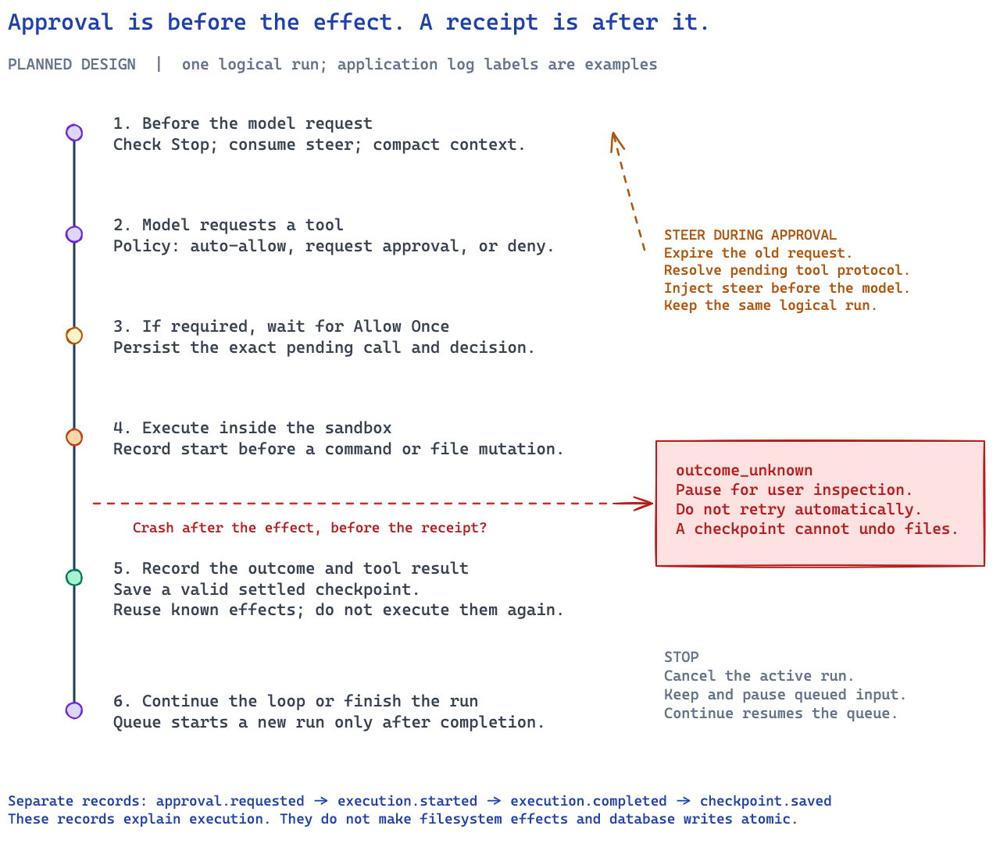

# Agent Execution and User Controls

Status: planned. The state names and log labels below are application examples. They are not framework event names.

## Framework loop and application controls

Pydantic AI owns model requests, tool dispatch, and output validation. The application owns user intent, permission decisions, persistence, and execution ownership. A checkpoint hook does not take those duties over.

Before each model request, the controller checks Stop, restores any protocol state the next step needs, consumes steer input that is eligible, and applies context management. It then lets the framework continue. Persist steer consumption with the recovery state, so a restart cannot inject the same message twice.

A safe boundary has a valid message history. Do not insert a new user message between a tool call and the result that call requires. For a tool batch, settle every call that started, and resolve every call that did not run, before the next model request. Check the exact public hooks against the pinned version.

## Queue, steer, and Stop

| Input | Active run | Queued input |
| --- | --- | --- |
| Queue | Continue unchanged | Append a new turn in FIFO order |
| Steer | Inject before the next model request | Keep existing queued turns |
| Steer while awaiting approval | Expire pending approvals and re-plan in the same logical run | Keep existing queued turns |
| Stop | Cancel; try to stop active commands | Preserve input and pause scheduling |
| Continue | Do not revive a cancelled run | Resume eligible queued turns |

The scheduler is separate from a run. A stopped run stays cancelled after Continue. A run waiting for approval holds its session's execution slot. It does not need to hold a scarce model-request permit, and it does not need to keep an idle container running.

When steer arrives during approval, record the invalidation before accepting any further decision. Finish the framework's pending-tool protocol without running the old plan. Keep the same logical run. Do not cancel it and start another. A stale approval response has no effect.

## Permission path

1. Check workspace restrictions and explicit denials.
2. Match a trusted auto-allow rule, if one exists.
3. Otherwise create a pending approval for mutations and commands.
4. Bind the decision to the exact call, its arguments, and the policy revision.
5. After approval, check the target again and record that execution has started, then call the tool.
6. Record the known outcome and return the tool result to the framework.

Allow Once covers one request. Reject Once returns a refusal to the agent. Approval does not override a denied path, a denied command, or a content conflict. MCP tools use the same path. Remote tool metadata does not grant permission by itself.

The official Shell command filter checks executable names and selected operators. It does not authorize a full shell command. Docker is the isolation boundary. See [Shell command controls](https://pydantic.dev/docs/ai/harness/shell/#command-controls).

## File events

The official FileSystem capability emits `FileChangeRequestEvent` before a change, and dispatches it immediately. Listeners finish before execution continues. After a successful edit, `FileEditedEvent` enters the run event stream. Stream listeners run in order. They are not a separate consumer thread.

Use the request event for preview and for a veto, where that fits. Use the completion event for display. Human approval also has to survive a process exit, so a callback that only waits in memory is not enough. A completion notification does not mean MySQL and the filesystem committed together. See [FileSystem events](https://pydantic.dev/docs/ai/harness/filesystem/#events).

## Display and ordering

When a run stops, keep the partial assistant output that was already committed. Mark it stopped. Do not treat it as a completed assistant answer in later model context. Keep completed tool results available for recovery. Show pending queue items, steer acceptance, approval state, and the scheduling pause as separate facts.

API requests use stable client identities. A duplicate submission returns the existing result. It must not apply Stop or steer a second time. Test the transaction and locking behavior before marking this design implemented.
