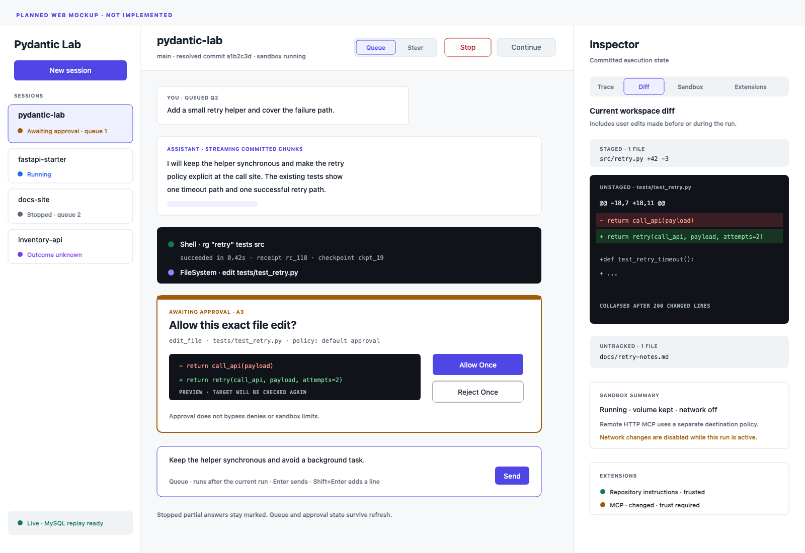
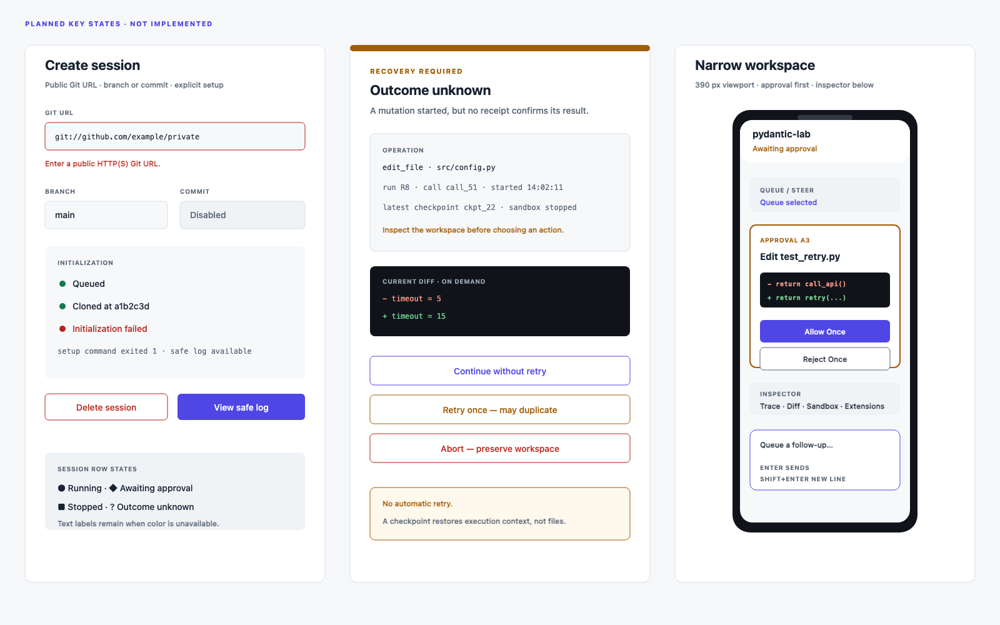

# Web Interaction Specification

Status: interaction contract for the implemented Web interface. Routes and event payloads are defined in [API source](../src/pydantic_lab/api/server.py) and [control source](../src/pydantic_lab/application/controls.py). See [implementation status](implementation-status.md) for verification coverage.

## Purpose and boundary

The Web UI makes execution state visible without hiding framework behavior. The browser talks only to the API server. The API commits user intent and serves snapshots and committed events. The agent server owns scheduling, execution, sandbox lifecycle, and runtime adaptation.

The UI targets one local user, one agent, public Git repositories, and independent session workspaces. It does not include login, teams, sub-agent delegation, private Git credentials, or a push workflow.

## Information architecture

Use two proposed browser routes:

| Route | Purpose |
| --- | --- |
| `/` | Session list and new-session action |
| `/sessions/:sessionId` | Chat workspace for one session |

At 1200 px or wider, the workspace has three regions:

1. **Session rail:** 280 px. New Session, session list, and connection state.
2. **Chat workspace:** flexible center. Session header, messages, tool trace, approvals, recovery notices, and composer.
3. **Inspector:** 460 px. Trace, Diff, Sandbox, and Extensions tabs.

At 800–1199 px, the session rail collapses into a drawer and the inspector becomes a right overlay. Below 800 px, use one column. Put the inspector below the transcript as tabs, and open the session rail as a modal drawer.

## Session list

Each session row shows:

- Repository name and host.
- Session status.
- Current branch or resolved commit.
- Last activity time.
- Queued count when greater than zero.
- Sandbox state when it needs attention.

Use these session display states:

| State | Meaning | Available session actions |
| --- | --- | --- |
| `provisioning` | Clone or initialization is running or waiting for a setup decision | Open progress and decide pending setup approvals; chat stays disabled |
| `ready` | No active run | Open, send, delete |
| `running` | A logical run is executing | Open, send Queue or Steer, Stop |
| `awaiting_approval` | A run waits for an exact decision | Open, decide, send Queue or Steer, Stop |
| `stopped` | The active run was cancelled and scheduling is paused | Open, Continue, delete |
| `outcome_unknown` | Recovery found a started mutation or command without a confirmed outcome | Open, inspect, Continue without retry, Retry once, Abort |
| `failed` | Initialization or execution ended with a known error | Open, inspect, send a new run when initialization completed, delete |
| `deleting` | Confirmed deletion is cleaning up resources | Open a read-only deletion status |
| `cleanup_failed` | Confirmed deletion did not finish cleanup | Open a read-only status and retry cleanup |

Show a waiting approval and a paused queue as separate facts. Do not merge them into a generic busy state.

## Create a session

The New Session dialog contains:

- **Git URL:** required public HTTP(S) URL.
- **Branch:** optional. Empty means the repository default branch.
- **Commit:** optional full SHA. Commit and Branch are mutually exclusive.
- **Session title:** optional. The UI derives a readable title from the repository when empty.
- **Advanced settings:** optional image and initialization commands permitted by the specification.
- **Network during initialization:** shown as enabled for clone and approved setup, then disabled for normal execution.

Validation happens before submission:

| Field | Rule | Error |
| --- | --- | --- |
| Git URL | Must be a supported public HTTP(S) Git URL | `Enter a public HTTP(S) Git URL` |
| Branch and Commit | Only one may be set | `Choose a branch or a commit, not both` |
| Initialization command | Must be explicit text; no hidden default | Show a validation or policy error |

After acceptance, the session appears immediately as `provisioning`. Show ordered initialization steps: `queued`, `cloning`, `initializing`, and `ready` or `failed`. Record and display the resolved commit. A failed session remains available for inspection and explicit deletion. Do not silently remove it.

A public URL failure says whether validation, clone, or initialization failed. Do not ask for private credentials in release one.

### Initialization approvals

Initialization commands follow the same auto-allow, approval, and deny policy as runtime commands. If a command needs approval, keep the session in `provisioning` and show an `awaiting_setup_approval` step. Pause before that exact command runs. The progress view shows its target, arguments, working directory, timeout, network access, and Allow Once / Reject Once controls. The chat composer remains disabled; setup decision controls remain enabled.

After Allow Once is accepted, recheck policy and the exact operation before execution. Show execution start only after the executor reports it. Reject Once or an explicit denial skips the command and ends initialization as `failed`, with the reason available for inspection and deletion. Repeated decisions use the same request identity. Stale decisions cannot start a command. Refresh or service restart restores the same pending setup request.

Setup approval permits only the displayed operation. It does not trust repository extensions or approve later agent tools.

## Switch and delete sessions

Switching sessions keeps the execution running. Save an unsubmitted composer draft per session in browser storage. Restore it when the user returns.

Delete requires Stop first while a run is active or waiting for approval. The Delete action is disabled with the reason `Stop the run before deleting this session`.

For a stopped, ready, failed, or unknown-outcome session, Delete opens a confirmation dialog that:

1. Names the repository and resolved commit.
2. States that the workspace volume and local session state will be removed.
3. States that deletion cannot be undone.
4. Requires the user to type `DELETE`.
5. Disables the primary action until the text matches.

Deletion first stops scheduling. It does not cancel an active tool by itself because the action was unavailable while execution was active. Cleanup failure moves the session to a visible cleanup-error state and leaves a retry action.

## Chat workspace

The header shows repository, branch or commit, session state, sandbox state, and the Queue/Steer selector. Keep Stop and Continue visible as text buttons.

The transcript uses a single chronological stream:

- User messages show the mode used: `Queued` or `Steer`.
- Assistant messages stream Markdown.
- Tool calls group their request, approval, execution, output, and receipt.
- Approval cards appear at the point where execution paused.
- Recovery and compaction notices appear as trace records, not assistant messages.
- Stopped partial answers show a `Stopped` marker.

### Message composer

Queue is the default while a run is active. The segmented selector shows `Queue` and `Steer`. It is enabled during `running` and `awaiting_approval`. In `ready`, the selector resets to Queue and send starts a run. In `stopped`, only Queue is enabled; send appends to the paused queue until Continue.

| Action | Precondition | Feedback | State change | Disabled condition |
| --- | --- | --- | --- | --- |
| Send Queue | `ready` and scheduling is not paused | `Run started` | Creates one run | Session provisioning, deleting, cleanup failure, or outcome unknown |
| Send Queue | `stopped` and scheduling is paused | Message shows `Queued`; queued count increases | Appends a durable FIFO item without starting it | Steer is unavailable because no logical run is active |
| Send Queue | Run active | Message shows `Queued`; queued count increases | Appends a durable FIFO item | Same provisioning and terminal-state limits |
| Send Steer | Run active or awaiting approval | Message shows `Steer recorded` | Records steer for the current logical run | No active logical run |
| Stop | Run active or awaiting approval | Button enters `Stopping`; then transcript shows `Stopped` | Cancels the run, invalidates pending approvals, keeps queue, pauses scheduling | No active run or Stop request already pending |
| Continue | Scheduling paused | Button enters `Starting`; next queued message becomes active | Resumes eligible queued work | Run active, no pause, or Continue request already pending |
| Continue | Paused with empty queue | `Scheduling resumed; queue is empty` | Clears the pause without reviving the cancelled run | Run active |

Enter sends. Shift+Enter inserts a newline. The composer remains available during a run. It is disabled only for `provisioning`, `deleting`, `cleanup_failed`, and `outcome_unknown` states that require a lifecycle or recovery decision.

## Streaming and event replay

The agent service commits coalesced assistant chunks to MySQL before the API serves them. Commit buffered text when a Markdown block closes, the buffer reaches 2 KiB, or the oldest buffered text has waited 100 ms, whichever comes first. The timer must also work while the provider sends no new data. Flush remaining text before recording completion, Stop, failure, or an approval/tool boundary. Do not publish a terminal event before that flush commits. A browser refresh can replay the same partial answer.

On session open, the browser requests a snapshot and then replays committed events after the snapshot cursor. The UI deduplicates event IDs. SSE supplies live updates after the initial state is loaded.

| Condition | UI behavior |
| --- | --- |
| SSE connected | Show a quiet `Live` indicator and render events in cursor order |
| SSE disconnected | Keep the last committed view; show `Reconnecting`; continue to allow API submissions when the API is reachable |
| Reconnect succeeds | Replay from the last committed cursor, deduplicate, then resume live events |
| Cursor is too old or invalid | Load a fresh snapshot, then replay; show `History refreshed` |
| API unavailable | Disable send and control buttons; keep drafts; show a clear error |
| Duplicate SSE event | Ignore the duplicate without visual flicker |
| Missed Redis hint | No visible failure; MySQL replay remains authoritative |

Reconnect uses exponential backoff with jitter. Start at 1 second and cap at 30 seconds. Do not reload the page automatically.

## Tool trace

Each tool group shows a status icon and text label. Status is never carried by color alone.

| Tool state | Display | Default expansion |
| --- | --- | --- |
| `requested` | Tool name and safe argument summary | Collapsed |
| `awaiting_approval` | Approval card | Expanded |
| `running` | Elapsed time and current safe output summary | Collapsed |
| `succeeded` | Duration, exit or edit status, and receipt identity | Collapsed |
| `failed` | Error summary and safe output | Expanded |
| `cancelled` | Stop source and settled state | Collapsed |
| `outcome_unknown` | Inspection panel | Expanded |

Long output collapses after 200 lines or 64 KiB, whichever comes first. Show the omitted amount. Loading full output is explicit.

## Approval cards

An approval card shows:

- Tool name and approval ID.
- Operation kind and target.
- Canonical arguments.
- Policy source.
- File preview or command preview.
- `Allow Once` and `Reject Once`.

A file preview is generated from pending edit arguments and current content. A command preview shows executable, arguments, working directory, timeout, and environment variable names. Secret values are redacted.

| Event | Approval card behavior |
| --- | --- |
| User selects Allow Once | Disable both buttons, show `Submitting`, then show `Allowed` only after the API accepts the decision |
| User selects Reject Once | Disable both buttons, show `Submitting`, then show `Rejected` only after the API accepts the decision |
| Duplicate click | No second request; the same client request identity returns the same result |
| Steer arrives before execution | Card becomes `Expired`; reason says steer changed the plan; buttons become disabled |
| Stop arrives before execution | Card becomes `Expired`; reason says the run stopped; buttons become disabled |
| Policy or trusted configuration changes | Card becomes `Expired`; reason names the revision change |
| Decision arrives for a stale card | The API rejects it; the UI shows `This approval has expired` and refreshes the card |
| Execution starts | Card moves to the tool group as a historical decision |

Approval has no time-based expiry. It persists across refresh and service restart until a decision, Stop, steer, or a policy/configuration revision change invalidates it. Approval does not bypass an explicit denial, sandbox restriction, or stale-target conflict.

## Queue, steer, Stop, and control races

Use stable client request identities for message, Stop, Continue, and approval submissions. A repeated click or retry returns the original result and does not apply the control twice.

If two controls race, the API transaction decides the accepted order. The UI displays the committed result, not the order in which buttons were pressed. Examples:

- Stop accepted before Steer: the steer request fails as `no active run`. The UI shows an explicit `Send as Queue` action; it never converts the message silently.
- Steer accepted before Stop: steer is recorded, then Stop cancels the run before it may be consumed.
- Approval decision accepted before steer: the exact operation may execute if it already passed the final pre-execution checks. Otherwise the decision is stale.
- Steer accepted before approval decision: the decision is stale and does not execute.

The UI never resolves these races locally.

## Diff panel

The Diff tab computes the current workspace diff on demand. It has three sections:

1. Staged changes.
2. Unstaged changes.
3. Untracked files.

The header says `Current workspace diff`. It also says that user edits made before or during the run can appear. Do not label the whole view as agent work.

Render file diffs with syntax highlighting and line numbers. Collapse a file after 200 changed lines. Show binary files and files without a safe text decoder as metadata only. Refresh is explicit. Do not create a historical diff store.

## Sandbox panel

The Sandbox tab shows the logical sandbox ID, container state, workspace volume, image identity, network state, resource limits, and last reconciliation result.

| State | Meaning | Available actions |
| --- | --- | --- |
| `stopped` | No container is running; the volume remains | Start, Rebuild, Network |
| `starting` | Container is being created or attached | None |
| `running` | Container is available | Stop only when no run is active |
| `stopping` | Stop is in progress | None |
| `rebuilding` | Container is being replaced and the volume kept | None |
| `error` | Docker or reconciliation failed | Retry the failed lifecycle action |

A Start action pre-warms the sandbox. It does not start an agent run. Automatic idle stop keeps the volume. A session waiting for approval can have its container stopped when no operation is executing.

A network change is enabled only when no run is active and no approval is pending. After confirmation, the sandbox manager applies the Docker network setting, verifies it, and only then reports the new state. If this requires a new container, Rebuild keeps the workspace volume. Container-layer changes and processes do not survive.

Show sandbox networking and remote HTTP MCP destinations separately. An offline tool sandbox does not take a remote MCP service offline.

## Extensions and trust

The Extensions tab has separate sections for Skills, MCP, and Repository Instructions.

| Trust state | Meaning | UI behavior |
| --- | --- | --- |
| `untrusted` | Discovered but inactive | Inspect and Trust actions are available when no run is active |
| `trusted` | Content identity matches the stored decision | Status shows the trusted content summary and time |
| `changed` | Relevant content no longer matches the trusted identity | Extension is inactive; Inspect and Trust again are available |
| `error` | Discovery or parsing failed | Error details and Retry discovery are available |

Trust is durable for the single local user, per repository identity, extension category, and relevant content identity. Skill trust includes support files. MCP trust covers normalized configuration. Repository-instruction trust covers the file set that RepoContext will load.

Inspect shows names, source paths, content summaries, and the identity that will be trusted. It does not execute scripts or start MCP servers. Trust changes are disabled while a run is active or an approval is pending.

Configuration trust is not execution approval. A trusted extension still uses the normal permission path for every mutation, command, and MCP tool call.

## Recovery and `outcome_unknown`

A recovery banner appears when the service restores a session with unresolved state. The banner identifies the last valid checkpoint, pending approvals, queued messages, sandbox state, and unresolved effects.

For `outcome_unknown`, show an inspection panel with:

- Operation kind, tool call ID, and logical run ID.
- Target path or command summary.
- Start time and last known sandbox state.
- Available receipt and output records.
- Links to the current diff and sandbox state.

Offer exactly three decisions:

| Decision | Effect | Required confirmation |
| --- | --- | --- |
| Continue without retry | Do not re-run the operation. Give the model an honest result that says the outcome was unknown and the user inspected the workspace. | Confirm that the model-facing result is manually reconciled |
| Retry once | Run the same operation one more time after explicit confirmation and a fresh policy check | Confirm that the first attempt may have had an effect |
| Abort | Cancel the logical run and preserve the workspace as it is | Confirm that Abort does not roll back completed effects |

Do not present automatic retry as safe. Do not hide the uncertainty behind a generic failed state.

## Empty, loading, failure, cancellation, partial, and success states

| Area | Empty | Loading | Failure | Cancelled or partial | Success |
| --- | --- | --- | --- | --- | --- |
| Session list | Show New Session guidance | Skeleton rows | Error banner with Retry | Deleting row is read-only | Rows show current status |
| Transcript | Explain that Queue starts a run | Skeleton assistant block only after acceptance | Inline error with safe details | `Stopped` marker on partial output | Complete answer and receipt summaries |
| Tool trace | `No tool calls yet` | Pending state | Expanded error | `Cancelled` label | Collapsed receipt summary |
| Approval | No card | Submitting state | Decision error with Retry | `Expired` with reason | `Allowed` or `Rejected` |
| Diff | `No current changes` | Loading diff | Git error with Retry | Large files collapsed | Current staged, unstaged, and untracked sections |
| Sandbox | No binding yet | Starting or reconciling | Error with retryable action | Stopping state | State, volume, network, and limits visible |
| Extensions | `No repository extensions discovered` | Discovery in progress | Discovery error | Changed trust requires review | Trusted categories listed |

## Scrolling and long content

Auto-scroll only when the user is already at the bottom. When the user scrolls up, pause auto-scroll and show a `New activity` pill with a count. Selecting it jumps to the newest committed event. Streaming never moves the viewport while the user reads history.

Collapse assistant messages after 40 rendered lines. Collapse tool output after 200 lines or 64 KiB. Collapse a file diff after 200 changed lines. Every collapsed region shows the omitted amount and an explicit Expand control.

## Keyboard, focus, and accessibility

- Enter sends the composer. Shift+Enter inserts a newline.
- `/` moves focus to the composer when no editable element has focus.
- Esc closes the topmost dialog, drawer, or inspector overlay. It does not stop a run.
- Tab follows the visual order: session rail, header controls, transcript actions, composer, inspector.
- Arrow keys move within the Queue/Steer segmented control after it receives focus.
- Dialogs trap focus, label their destructive actions, and return focus to the opener.
- New approval cards preserve the current focus, draft, and selection. Announce the request through a live region and offer a Review approval action. Only an explicit review action moves focus into the card. An arriving card must not turn Enter in the composer into Allow Once.
- Every interactive element has a visible focus outline and an accessible name.
- Do not use color as the only state signal. Pair color with text or an icon.
- Touch targets are at least 44 by 44 px.

## Narrow screens

Below 800 px:

- The session rail becomes a drawer.
- The inspector appears below the transcript.
- Header actions keep text labels; do not collapse Stop into an unnamed icon.
- Approval cards use one column and keep both decisions visible without horizontal scrolling.
- Diff code uses horizontal scrolling inside the code block, not page-level scrolling.
- The composer stays anchored above the browser keyboard safe area.

## Acceptance criteria

These criteria define planned observable behavior for unit, integration, and browser tests.

| ID | Given | When | Then |
| --- | --- | --- | --- |
| WEB-AC-01 | The session list has mixed states | The page renders | Running, awaiting approval, stopped, unknown, failed, and queued counts use distinct text labels |
| WEB-AC-02 | New Session is open | Both Branch and Commit are set | Submit is disabled and the mutual-exclusion error is visible |
| WEB-AC-03 | A public Git URL is accepted | Initialization runs | The session shows queued, cloning, initializing, then ready or failed; the resolved commit is displayed |
| WEB-AC-04 | Initialization fails | The user opens the session | The failing step and safe error remain available, and Delete is available |
| WEB-AC-05 | A run is active | The user sends a message with Queue selected | The message is committed as FIFO follow-up and does not alter the active run |
| WEB-AC-06 | A run is active | The user sends Steer | The UI shows acceptance first and consumption only at a safe model boundary |
| WEB-AC-07 | Approval is pending | The user sends Steer | The card becomes expired, its decision controls disable, and the same logical run re-plans |
| WEB-AC-08 | An approval card is visible | The user double-clicks Allow Once | One decision request is accepted and no duplicate execution occurs |
| WEB-AC-09 | An approval becomes stale | A stale decision response arrives | The UI shows the expired reason and no operation executes |
| WEB-AC-10 | Stop is clicked during a run | The API accepts Stop | The partial answer is marked stopped, queued input remains, and Continue becomes available when eligible |
| WEB-AC-11 | A stopped session has queued work | Continue is clicked | The oldest queued message starts and the cancelled run is not revived |
| WEB-AC-12 | Stop and Steer race | Both requests are submitted | The UI displays the committed order from the API and does not decide locally |
| WEB-AC-13 | SSE disconnects during streaming | The browser reconnects | Snapshot plus ordered replay restores the same committed partial answer without duplicates |
| WEB-AC-14 | Redis hints are lost | Events remain in MySQL | The browser still receives the final ordered state through replay |
| WEB-AC-15 | The user scrolls up during streaming | New events arrive | The viewport stays in place and a New activity pill appears |
| WEB-AC-16 | Tool output exceeds the limit | The trace renders | The output is collapsed with the omitted amount and an explicit expansion path |
| WEB-AC-17 | The workspace has staged, unstaged, and untracked changes | Diff is refreshed | The three sections are separate and the header says current workspace diff |
| WEB-AC-18 | A run is active | The Sandbox tab renders | Stop, Rebuild, Network, and trust changes are disabled with reasons |
| WEB-AC-19 | No run is active | Network is changed | The UI reports the new state only after the Docker change is applied and verified |
| WEB-AC-20 | Remote HTTP MCP is configured while the sandbox is offline | The Sandbox tab renders | Sandbox networking and remote MCP destinations appear as separate settings |
| WEB-AC-21 | Trusted skill content changes | The Extensions tab renders | The category is changed and inactive until the user trusts the new content identity |
| WEB-AC-22 | A trusted extension requests a mutation | The tool runs | The normal execution approval policy still applies |
| WEB-AC-23 | Recovery finds an unresolved mutation | The session opens | The state is outcome_unknown and exactly Continue without retry, Retry once, and Abort are available |
| WEB-AC-24 | The user chooses Retry once after unknown outcome | Confirmation opens | The possible duplicate effect warning is explicit and no automatic retry occurs |
| WEB-AC-25 | A run is active | The user opens Delete | Delete is disabled and says Stop is required first |
| WEB-AC-26 | A stopped session is deleted | The confirmation opens | The user must type DELETE and the dialog names the irreversible workspace cleanup |
| WEB-AC-27 | The viewport is 700 px wide | An approval card appears | Both decisions and the full target remain reachable without page-level horizontal scrolling |
| WEB-AC-28 | A new approval appears while the user types in the composer | Accessibility announcements run | The approval is announced; focus, draft, and selection stay in the composer, and Enter cannot approve the operation |
| WEB-AC-29 | A stopped session has paused scheduling | The user sends Queue | The message is stored, no run starts, and Continue remains the only scheduling resume action |
| WEB-AC-30 | The user has an unsubmitted draft | They switch sessions and return | The draft is restored for the original session only |
| WEB-AC-31 | SSE disconnects repeatedly | Reconnect attempts run | Backoff starts at 1 second, uses jitter, and stops increasing at 30 seconds |
| WEB-AC-32 | Stop is committed before a steer submission | The steer response returns | The message is not silently queued; the UI offers an explicit Send as Queue action |
| WEB-AC-33 | Session title is empty | The form is accepted | The UI derives the title from the repository name and shows it in the list |
| WEB-AC-34 | Deletion cleanup fails | The session list renders | The session is cleanup_failed, read-only, and exposes Retry cleanup |
| WEB-AC-35 | An approval is pending and the browser refreshes | The service has not invalidated it | The same exact approval card, arguments, and policy revision render |
| WEB-AC-36 | A sandbox container is rebuilt | The recorded image and volume are used | The UI shows volume retained and container-layer state not restored |
| WEB-AC-37 | Automatic idle stop runs while approval is pending and no operation executes | The Sandbox tab renders | The container is stopped, the volume remains, and the session stays awaiting_approval |
| WEB-AC-38 | Initialization reaches a command requiring approval | The progress view renders | Chat stays disabled, setup decisions remain available, and the command waits for its exact approval |
| WEB-AC-39 | Setup approval is pending | The user rejects it or refreshes | Rejection ends initialization as failed without executing the command; refresh preserves an undecided request |
| WEB-AC-40 | Buffered output is below 2 KiB and has no closed Markdown block | The provider pauses for more than 100 ms | The oldest text is committed by the timer and becomes available for SSE replay |
| WEB-AC-41 | Output remains buffered | Completion, Stop, failure, or an approval/tool boundary occurs | The text commits before the boundary event; replay contains it exactly once |
| WEB-AC-42 | An approval notification is visible | The user explicitly selects Review approval | Focus moves into the card; no approval decision is submitted by the focus change |

## Framework references

Use official capabilities as the boundary for implementation:

- Pydantic AI Agent streaming and cancellation: <https://pydantic.dev/docs/ai/core-concepts/agent/>
- Deferred tools and results: <https://pydantic.dev/docs/ai/tools-toolsets/deferred-tools/>
- StepPersistence and tool-effect recovery records: <https://pydantic.dev/docs/ai/harness/step-persistence/>
- DockerSandbox lifecycle and security model: <https://pydantic.dev/docs/ai/harness/docker-sandbox/>
- Skills, RepoContext, and MCP: <https://pydantic.dev/docs/ai/harness/skills/>, <https://pydantic.dev/docs/ai/harness/repo-context/>, <https://pydantic.dev/docs/ai/mcp/client/>

These links identify concepts. They do not prove that a symbol exists in the versions this repository will pin.
